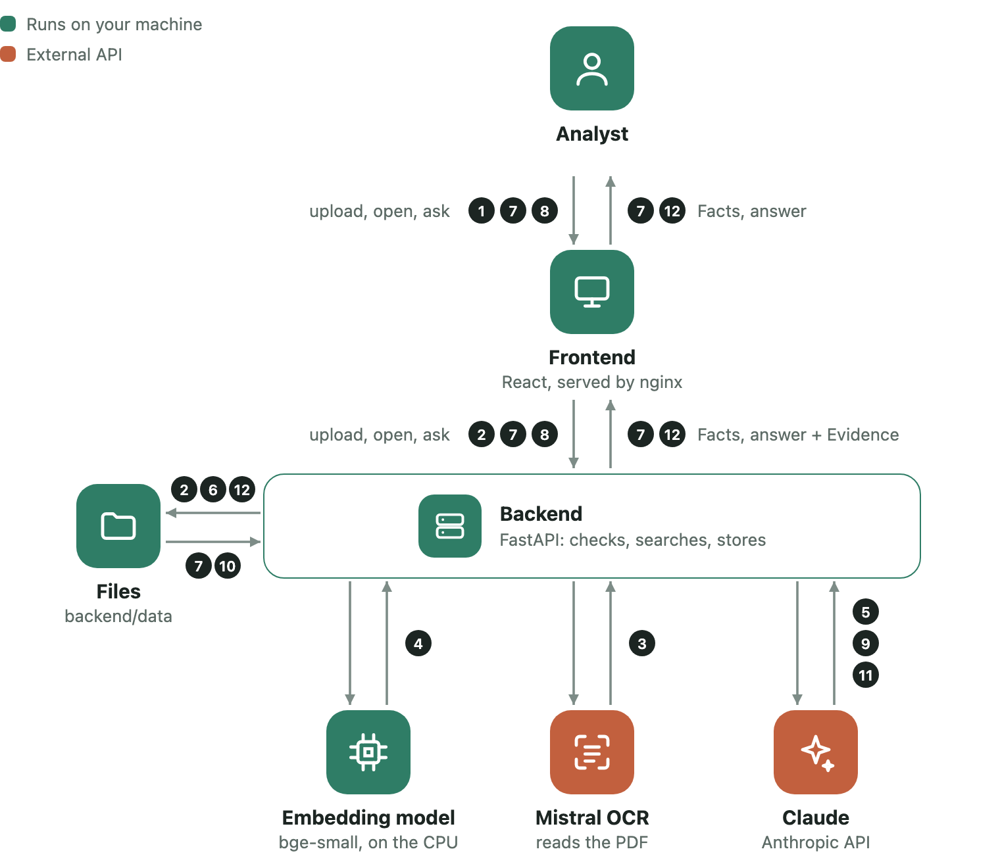

# Report analyst

Ask about the FTE and sustainability goals in companies' annual reports and get answers you can check. Every answer quotes the report word for word and shows the page, with the quoted passage highlighted. If the report doesn't say, the answer is "Not Found" instead of a guess.

- **Add a report.** Upload a PDF and type its Company and Reporting Year. Processing then runs in the background: it reads the text, renders the pages, builds a search index and extracts two facts, the total **FTE** and the **sustainability goals**, each with its evidence.
- **Browse a report.** Open it from the Reports drawer to see its facts next to the PDF page each one comes from.
- **Chat.** Ask about the FTE or the sustainability goals in plain English, e.g. "How many FTE did Shell have in 2024?" or "Compare the goals of ABN 2025 and Shell 2025". Claude first matches the question to the stored reports, short names included; a Company or year with no stored report is named back to you, and a question about anything else gets "Sorry, we only support questions about the FTE and sustainability goals". It then answers from the facts extracted while processing. Conversations are kept across restarts.

Everything runs on your machine except two API calls: Mistral reads the PDF's text, and Claude writes the facts and answers. Data is stored as files under `backend/data/`.

| | |
|---|---|
|  |  |
| An answer with its evidence: each quote is verbatim, with its page | A report's facts beside the page they come from, the quote highlighted |
|  |  |
| Asked about a report that isn't stored, the answer is "Not Found" and names it | The Reports drawer: add a report, see whether it's ready |

## How it works

<picture>
  <source media="(prefers-color-scheme: dark)" srcset="docs/screenshots/how-it-works-dark.png">
  
</picture>

| Step | What happens | Where |
|---|---|---|
| | **Adding a report** (once per report, in the background) | |
| 1 | The analyst uploads a PDF with its Company and year | Analyst → Frontend |
| 2 | The backend checks the PDF and stores it | Backend → Files |
| 3 | Mistral OCR reads the text and where it sits on each page | Mistral OCR |
| 4 | The backend splits the text into Passages and embeds them for search | Embedding model |
| 5 | The backend searches for FTE and goal Passages; Claude extracts the Facts with verbatim quotes | Claude |
| 6 | The backend checks each quote against its page, then saves the Passages, page images and Facts | Files |
| | **Browsing a report** | |
| 7 | The analyst opens a ready report and sees its Facts beside the page each one comes from, the quote highlighted | Analyst → Frontend → Backend → Files |
| | **Asking a question** | |
| 8 | The analyst asks a question | Analyst → Frontend → Backend |
| 9 | Claude reads it: which fact, which Company and year | Claude |
| 10 | The backend finds the matching reports and loads their Facts | Files |
| 11 | Claude writes the answer, citing the Facts | Claude |
| 12 | The backend saves the Conversation; the frontend shows the answer with each quote highlighted on its page, or Not Found | Files, Frontend |

Chat never reads the PDF again: it answers only from the Facts saved while processing, so every quote was already checked against its page. [ARCHITECTURE.md](ARCHITECTURE.md) has each step in detail.

## What you need

### API keys

| Key | Used for | Where to get it |
|---|---|---|
| `ANTHROPIC_API_KEY` | Extracting the facts and answering questions, with Claude (`claude-opus-5-5` by default) | [console.anthropic.com](https://console.anthropic.com) → API Keys |
| `MISTRAL_API_KEY` | Reading the PDF's text with Mistral OCR (`mistral-ocr-latest`), including where each paragraph is on the page | [console.mistral.ai](https://console.mistral.ai) → API Keys |

Both are paid APIs. Processing a report makes one OCR call and one Claude call (retried up to twice if its output fails validation); each question makes two Claude calls, one to read the question and one to answer it.

### The embedding model

Search uses [bge-small-en-v1.5](https://huggingface.co/BAAI/bge-small-en-v1.5) (ONNX, about 64 MB) through fastembed. It runs locally, on the CPU; there is no GPU or PyTorch requirement. It lives in `models/fastembed/` and is copied into the Docker image, which never downloads anything at runtime.

If `models/fastembed/` is missing, download it once (needs the backend's Python environment, see below):

```bash
cd backend
uv run python -c "from fastembed import TextEmbedding; TextEmbedding('BAAI/bge-small-en-v1.5', cache_dir='../models/fastembed')"
```

### Software

- To run it: [Docker](https://docs.docker.com/get-docker/) with Compose.
- To develop: Python 3.14 with [uv](https://docs.astral.sh/uv/), and Node.js 24.

## Run it

1. Put the keys in `.env` at the repository root:

   ```bash
   cp .env.example .env
   # then fill in ANTHROPIC_API_KEY and MISTRAL_API_KEY
   ```

2. Start it:

   ```bash
   docker compose up --build
   ```

3. Open [http://localhost:8080](http://localhost:8080) and add a report. `samples/` has annual reports to try. A 400-page report takes a few minutes to process, mostly embedding its text on the CPU; the list shows its status (Processing, Ready or Failed).

The API's own docs are at [http://localhost:8000/docs](http://localhost:8000/docs).

### Without Docker

Backend, from `backend/`:

```bash
uv sync
uv run --env-file ../.env uvicorn report_analyst.main:app --reload
```

Frontend, from `frontend/` (serves on [http://localhost:5173](http://localhost:5173) and forwards `/api` to the backend on port 8000):

```bash
npm ci
npm run dev
```

### Settings

Optional, in `.env`; the defaults are listed in `.env.example`.

| Setting | Default | |
|---|---|---|
| `ANTHROPIC_MODEL` | `claude-opus-5-5` | The Claude model |
| `MAX_UPLOAD_MB` | `100` | The largest PDF accepted |
| `REPORTS_DIR` | `data/reports` | Where reports are stored, relative to `backend/` |
| `CONVERSATIONS_DIR` | `data/conversations` | Where conversations are stored, relative to `backend/` |
| `EMBEDDING_MODEL` | `BAAI/bge-small-en-v1.5` | Changing it means uploading every report again |
| `MODELS_DIR` | `../models` | Where the embedding model is |

## Check it

```bash
cd backend && uv run pytest && uv run ruff check && uv run ruff format --check && uv run mypy src
cd frontend && npm run check   # prettier, eslint, stylelint, typecheck and vitest
```

The tests need no API keys: Claude, Mistral and the embedding model are replaced by fakes.

## Where to read next

- [ARCHITECTURE.md](ARCHITECTURE.md): the layers and what each file does, how chat and processing work, and what was deliberately left out.
- [API.md](API.md): the endpoints and their shapes.
- [UBIQUITOUS_LANGUAGE.md](UBIQUITOUS_LANGUAGE.md): the terms (Report, Passage, Evidence, Facts…) as the code and UI use them.

## Data extraction experiments

Three different PDF extractors were tried behind one `PdfExtractor` interface.

| Method | Result | Why we moved on / stayed |
|---|---|---|
| 1. PyMuPDF (pymupdf4llm) | ~1 min / 300 pages, local | Fast, but no positions: we can't highlight the evidence on the page |
| 2. Docling | Several minutes / 300 pages, local | Good tables and boxes, but slow, memory-hungry (had to process 20 pages at a time) and pulls in PyTorch |
| 3. Mistral OCR (**default**) | 33 s / 307 pages | Typed blocks (title, text, table) with boxes, headers/footers dropped. Trade-off: the PDF goes to Mistral's API |

## Next steps

1. **Answer more than the FTE and the sustainability goals.** Today chat answers only from the two Facts extracted while processing, and any other question gets "Sorry, we only support…". Ideally it covers any topic in the report. Most of the pieces already exist: each report has a hybrid search index over its Passages, which processing uses to find the Fact candidates. For other topics, step 1 would return the topic instead of null, step 2 would search the matched reports' Passages for it, and step 3 would answer citing those Passages, with verbatim quotes and page highlights as today. The two Facts would stay as the fast, pre-checked answer for the most common questions.
2. **Async calls for production.** Today nothing is `async`, on purpose: it's built for one analyst on one machine (see [ARCHITECTURE.md](ARCHITECTURE.md)). With many users, each chat question waiting on Claude holds a thread from FastAPI's pool. Before going to production, move the chat route and the Claude and Mistral clients to their async versions (`async def` routes, `anthropic.AsyncAnthropic`), and replace the in-memory processing queue with a real job queue (arq, RQ) so jobs survive restarts and can run on more workers.
3. **A database, with migrations.** Today reports and Conversations are files, which is enough for one process (see [ARCHITECTURE.md](ARCHITECTURE.md)). With several processes or users, move the metadata, Facts and Conversations to PostgreSQL, behind the existing repositories so the services don't change, and keep PDFs and page images in object storage. Manage the schema with Alembic, so a change like renaming a field is a versioned migration that runs on deploy, not a one-off script like `scripts/migrate_field_names.py`. When the number of reports or users outgrows the in-memory, per-report index, move the embeddings to a vector store that supports hybrid search and metadata filtering by company and year.
4. **Evaluate fact extraction.** Measure the recall of the FTE and the Sustainability Goals. Label a set of reports by hand: the FTE figure and every goal, each with its page. Then score what processing extracts against those labels: is the FTE found and correct, and what share of the labelled goals is found (with precision alongside, so a long list of non-goals doesn't look good). Run it whenever the prompt, the search queries or the PDF extractor change.
5. **Evaluate the chat** with LangWatch's [agentic AI testing framework](https://langwatch.ai/agentic-ai-testing) (Scenario). A simulated user holds whole Conversations with the chat, follow-ups included ("and in 2025?"), and a judge checks each one against written criteria. Build the scenarios from Questions with known answers, including some the reports don't answer, and check that each Answer is right, that its Evidence quotes the page that states it, and that the unanswerable ones come back Not Found rather than a guess. The scenarios run as tests, so they can run in CI next to the existing suite.
