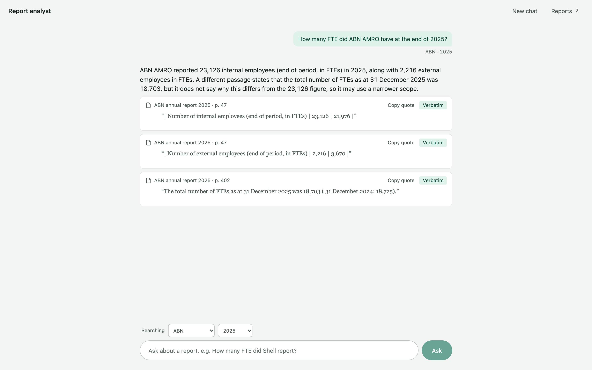
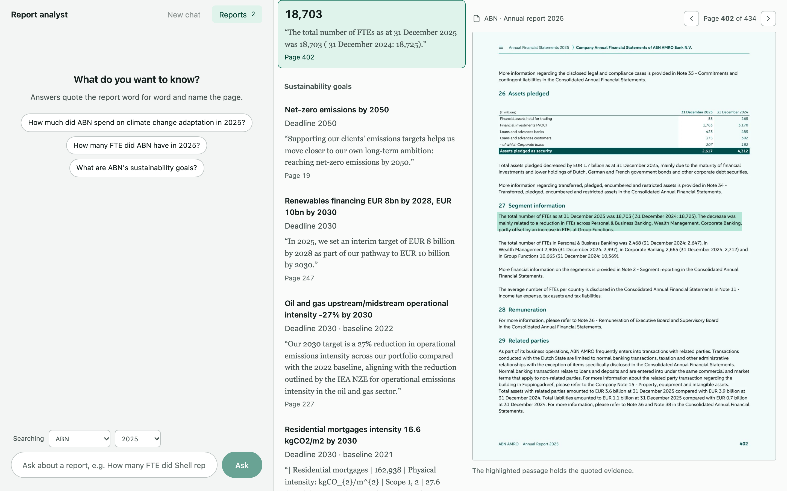
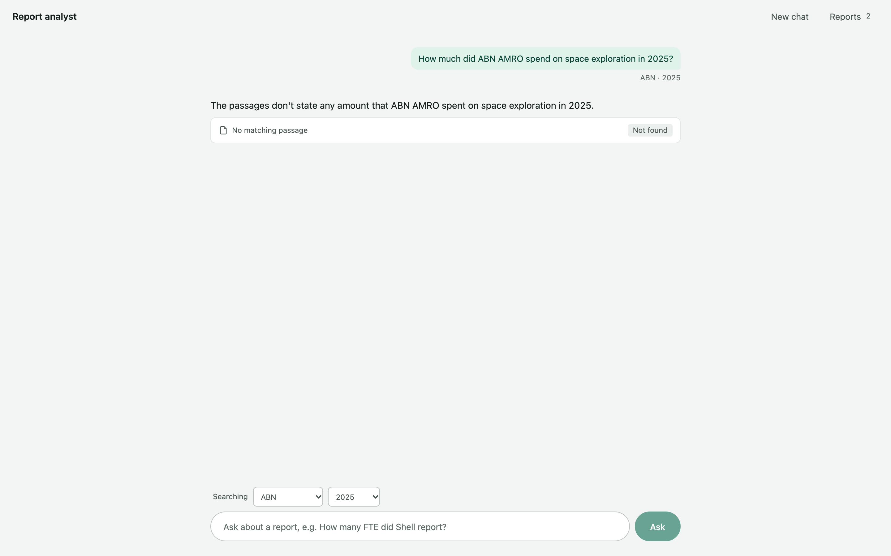
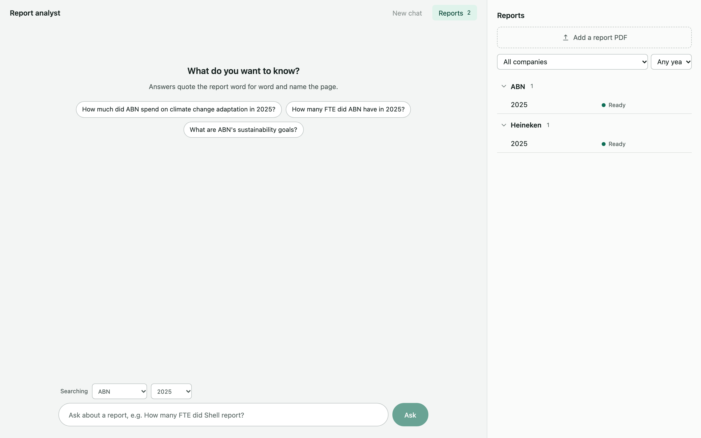

# Report analyst

Ask questions about companies' annual reports and get answers you can check. Every answer quotes the report word for word and shows the page, with the quoted passage highlighted. If the report doesn't say, the answer is "Not Found" instead of a guess.

- **Add a report.** Upload a PDF and type its Company and Reporting Year. Processing then runs in the background: it reads the text, renders the pages, builds a search index and extracts two facts, the total **FTE** and the **sustainability goals**, each with its evidence.
- **Browse a report.** Open it from the Reports drawer to see its facts next to the PDF page each one comes from.
- **Chat.** Ask in plain English, e.g. "How many FTE did Shell have in 2024?". A Company or year named in the question sets the scope; otherwise the selects under the input do. Conversations are kept across restarts.

Everything runs on your machine except two API calls: Mistral reads the PDF's text, and Claude writes the facts and answers. Data is stored as files under `backend/data/`.

| | |
|---|---|
|  |  |
| An answer with its evidence: each quote is verbatim, with its page | A report's facts beside the page they come from, the quote highlighted |
|  |  |
| When the reports don't say, the answer is "Not Found" | The Reports drawer: add a report, see whether it's ready |

## What you need

### API keys

| Key | Used for | Where to get it |
|---|---|---|
| `ANTHROPIC_API_KEY` | Extracting the facts and answering questions, with Claude (`claude-opus-5-5` by default) | [console.anthropic.com](https://console.anthropic.com) → API Keys |
| `MISTRAL_API_KEY` | Reading the PDF's text with Mistral OCR (`mistral-ocr-latest`), including where each paragraph is on the page | [console.mistral.ai](https://console.mistral.ai) → API Keys |

Both are paid APIs. Processing a report makes one OCR call and one Claude call (retried up to twice if its output fails validation); each question makes one Claude call.

### The embedding model

Search uses [bge-small-en-v1.5](https://huggingface.co/BAAI/bge-small-en-v1.5) (ONNX, about 64 MB) through fastembed. It runs locally, on the CPU; there is no GPU or PyTorch requirement. It lives in `models/fastembed/` and is copied into the Docker image, which never downloads anything at runtime.

If `models/fastembed/` is missing, download it once (needs the backend's Python environment, see below):

```bash
cd backend
uv run python -c "from fastembed import TextEmbedding; TextEmbedding('BAAI/bge-small-en-v1.5', cache_dir='../models/fastembed')"
```

### Software

- To run it: [Docker](https://docs.docker.com/get-docker/) with Compose.
- To develop: Python 3.14 with [uv](https://docs.astral.sh/uv/), and Node.js 24.

## Run it

1. Put the keys in `.env` at the repository root:

   ```bash
   cp .env.example .env
   # then fill in ANTHROPIC_API_KEY and MISTRAL_API_KEY
   ```

2. Start it:

   ```bash
   docker compose up --build
   ```

3. Open [http://localhost:8080](http://localhost:8080) and add a report. `samples/` has annual reports to try. A 400-page report takes a few minutes to process, mostly embedding its text on the CPU; the list shows its status (Processing, Ready or Failed).

The API's own docs are at [http://localhost:8000/docs](http://localhost:8000/docs).

### Without Docker

Backend, from `backend/`:

```bash
uv sync
uv run --env-file ../.env uvicorn report_analyst.main:app --reload
```

Frontend, from `frontend/` (serves on [http://localhost:5173](http://localhost:5173) and forwards `/api` to the backend on port 8000):

```bash
npm ci
npm run dev
```

### Settings

Optional, in `.env`; the defaults are listed in `.env.example`.

| Setting | Default | |
|---|---|---|
| `ANTHROPIC_MODEL` | `claude-opus-5-5` | The Claude model |
| `MAX_UPLOAD_MB` | `100` | The largest PDF accepted |
| `REPORTS_DIR` | `data/reports` | Where reports are stored, relative to `backend/` |
| `CONVERSATIONS_DIR` | `data/conversations` | Where conversations are stored, relative to `backend/` |
| `EMBEDDING_MODEL` | `BAAI/bge-small-en-v1.5` | Changing it means uploading every report again |
| `MODELS_DIR` | `../models` | Where the embedding model is |

## Check it

```bash
cd backend && uv run pytest && uv run ruff check && uv run ruff format --check && uv run mypy src
cd frontend && npm run check   # prettier, eslint, stylelint, typecheck and vitest
```

The tests need no API keys: Claude, Mistral and the embedding model are replaced by fakes.

## Where to read next

- [ARCHITECTURE.md](ARCHITECTURE.md): the layers and what each file does, how chat and processing work, and what was deliberately left out.
- [API.md](API.md): the endpoints and their shapes.
- [UBIQUITOUS_LANGUAGE.md](UBIQUITOUS_LANGUAGE.md): the terms (Report, Passage, Evidence, Facts…) as the code and UI use them.

## Data extraction experiments

Three different PDF extractors were tried behind one `PdfExtractor` interface.

| Method | Result | Why we moved on / stayed |
|---|---|---|
| 1. PyMuPDF (pymupdf4llm) | ~1 min / 300 pages, local | Fast, but no positions: we can't highlight the evidence on the page |
| 2. Docling | Several minutes / 300 pages, local | Good tables and boxes, but slow, memory-hungry (had to process 20 pages at a time) and pulls in PyTorch |
| 3. Mistral OCR (**default**) | 33 s / 307 pages | Typed blocks (title, text, table) with boxes, headers/footers dropped. Trade-off: the PDF goes to Mistral's API |
